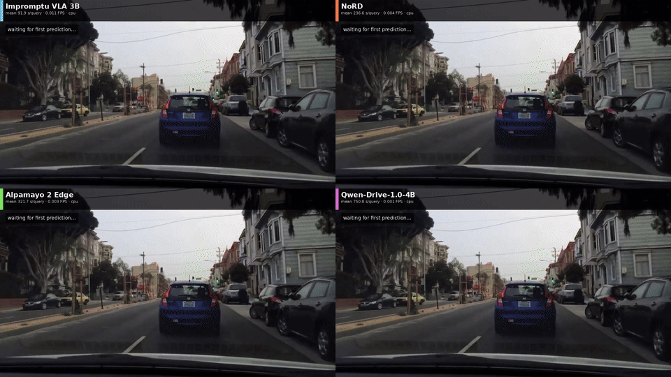

# vlarena

Run several driving VLAs on the **same front-camera video** and render a tiled
comparison video (one tile per model). No ground truth; this is a qualitative
side-by-side of trajectories, reasoning text and speed.




## Get started

1. **Clone**
   ```bash
   git clone https://github.com/dronefreak/vlarena.git && cd vlarena
   ```
2. **Log in to Hugging Face** (weights are downloaded from the Hub)
   ```bash
   hf auth login
   ```
3. **Build** envs + fetch weights (~45 GB disk; needs `git`, `ffmpeg`)
   ```bash
   ./setup.sh cuda    # GPU servers  (or: ./setup.sh cpu)
   ```
4. **Quick test**: one query per model
   ```bash
   .venv/bin/python compare.py --video clip.mp4 --gpus 0,1,2 --max-queries 1
   ```
5. **Run** the whole clip → `outputs/<clip>_offline.mp4`
   ```bash
   .venv/bin/python compare.py --video clip.mp4 --gpus 0,1,2
   .venv/bin/python compare.py --video clip.mp4 --render-only --realtime   # latency-aware view
   ```

```
video.mp4 ─► runners/run_<model>.py (each in its own env) ─► results/<clip>/<model>.jsonl
                                                                    │
                                         vlacompare/render.py ◄─────┘ ─► outputs/<clip>_<mode>.mp4
```

## Setup

```bash
./setup.sh cuda    # GPU servers: CUDA torch + flash-attn / causal-conv1d / fla kernels
./setup.sh cpu     # CPU-only machines
```

## Quick start

```bash
# GPU server (e.g. 3x A5000): one model per GPU, concurrently; the 4th queues
.venv/bin/python compare.py --video clip.mp4 --gpus 0,1,2

# CPU only (default when --gpus is omitted): one model at a time, hard RAM cap each
.venv/bin/python compare.py --video clip.mp4

# re-render from cached results (seconds), e.g. latency-aware "realtime" mode
.venv/bin/python compare.py --video clip.mp4 --render-only --realtime
```

Useful flags: `--models alpamayo qwen_drive impromptu nord`, `--stride 1.0` (seconds
between queries), `--max-queries N`, `--nav straight|left|right`, `--speed 8` (assumed
ego m/s), `--dtype bfloat16`, `--hfov 65 --horizon 0.5` (drawing-only camera guess).
GPU runs log to `logs/<clip>_<model>.log`.

**Latency numbers are hardware-specific**: the FPS shown on each tile is what that
run measured (CPU runs are orders of magnitude slower than GPU).

## Model settings (upstream originals)

| model | settings |
| --- | --- |
| Alpamayo 2 Edge | bf16, SDPA, 1 set × 1 sample, temp 0.6, top-p 0.98, 256 tokens, 10 flow steps, seed 43 (upstream CLI defaults) |
| Qwen-Drive-1.0-4B | bf16, FlashAttention-2 on GPU (SDPA otherwise), `planner-rl` + reasoning planning, config pixel budgets / reasoning length / noise seed |
| Impromptu VLA 3B | `3B_AD_finetune`, bf16, image pixels 1024–262144, greedy (upstream temp 0.01 / top-k 1), up to 3000 new tokens, upstream nuScenes planning prompt |
| NoRD | bf16, temp 1.0, top-p 1.0, guided decoding to 8 `TRAJ_####` tokens, JPEG-encoded images as the vLLM client sends; served via transformers instead of vLLM |

## Render modes

- **offline** (default): each model's latest prediction is shown from its query time
  onward, so models are compared on identical frames.
- **realtime** (`--realtime`): a prediction appears only after its measured latency
  has passed, so slow models visibly lag the scene.

## Models

| key | model | env | inputs synthesized from a single dashcam |
| --- | --- | --- | --- |
| `alpamayo` | NVIDIA Alpamayo 2 Edge (2B) | `third_party/alpamayo2-edge/.venv` (uv, locked) | tele = 2× center crop; 4 side/rear cams black; straight ego history; nav text |
| `qwen_drive` | Qwen-Drive-1.0-4B + planner-rl | `third_party/Qwen-Drive-1.0/.venv` | front-left/right black; straight ego history, zero accel; nav command |
| `impromptu` | Impromptu VLA 3B (Qwen2.5-VL) | `envs/qwen25vl` | speed only (accel/steer = 0); no route input in its prompt |
| `nord` | NoRD (Qwen2.5-VL-3B + Dr.GRPO) | `envs/qwen25vl` | front-left/right black; straight past trajectory; command |

In CPU mode runners hide all GPUs (`CUDA_VISIBLE_DEVICES=""`), run at `nice 19`
with capped threads, inside a `systemd-run` scope with a hard RAM cap, so a GPU
job on the same machine is never touched.

These models are being fed out-of-distribution input (missing cameras, fake ego
history), so the video shows *how each copes with front-cam-only input*, not
benchmark-quality behaviour.

## Adding a model

1. Put the repo in `third_party/`, create its env.
2. Write `runners/run_<name>.py`: decode frames with `vlacompare.common.read_frames`,
   write one `Prediction` per query time with `ResultWriter` (ego frame, x forward,
   y left, metres).
3. Register it in `MODELS` / `NAV_MAP` in `compare.py`.

## Layout

- `vlacompare/common.py` — video decode (ffmpeg), synthetic inputs, `Prediction`, JSONL I/O
- `vlacompare/render.py` — overlays (trajectory ribbon, BEV inset, text) and tiling
- `runners/` — one script per model, executed with that model's interpreter
- `third_party/`, `weights/` — upstream repos and checkpoints (not ours)
- `results/`, `outputs/`, `logs/` — generated

## Contributing

Contributions are welcome, especially new model runners. See
[CONTRIBUTING.md](CONTRIBUTING.md) and the [Code of Conduct](CODE_OF_CONDUCT.md).

## License

vlarena's code is licensed under the [Apache License 2.0](LICENSE).
Copyright 2026 [dronefreak](https://github.com/dronefreak) (kumaar324@gmail.com).

**Model weights are not part of this repo**: they are downloaded from upstream and
keep their own licenses. Some are **non-commercial** (e.g. NoRD: CC BY-NC-SA 4.0).
See [NOTICE](NOTICE) for each model's license.

vlarena is a research/visualisation tool, not a driving system; never use model
outputs to control a vehicle.

## References

**Models**

- **Alpamayo 2 Edge**: NVIDIA, 2026. [Model card](https://huggingface.co/nvidia/Alpamayo2-Edge) ·
  [Code](https://github.com/NVlabs/alpamayo2-edge) ·
  [Blog: Running AV Reasoning Models Within Onboard Compute and Latency Limits](https://developer.nvidia.com/blog/running-av-reasoning-models-within-onboard-compute-and-latency-limits/)
- **Qwen-Drive-1.0**: Qwen Team. *Qwen-Drive-1.0: An Initial Step towards a
  Vision-Language Foundation Model for Autonomous Driving*, 2026.
  [arXiv:2609.00111](https://arxiv.org/abs/2609.00111) ·
  [Code](https://github.com/QwenLM/Qwen-Drive-1.0) ·
  [Model card](https://huggingface.co/Qwen/Qwen-Drive-1.0-4B)
- **Impromptu VLA**: *Impromptu VLA: Open Weights and Open Data for Driving
  Vision-Language-Action Models*, NeurIPS 2025 (Datasets & Benchmarks).
  [arXiv:2505.23757](https://arxiv.org/abs/2505.23757) ·
  [Code](https://github.com/ahydchh/Impromptu-VLA) ·
  [Weights](https://huggingface.co/aaaaaap/ImpromptuVLAModel)
- **NoRD**: I. Rawal, S. Gupta, Y. Hu, W. Zhan. *NoRD: A Data-Efficient
  Vision-Language-Action Model that Drives without Reasoning*, CVPR 2026.
  [arXiv:2602.21172](https://arxiv.org/abs/2602.21172) ·
  [Code](https://github.com/Applied-Intuition-Open-Source/nord) ·
  [Model card](https://huggingface.co/AppliedIntuitionResearch/nord)

**Data used in the demo**

- **BDD-A**: Y. Xia, D. Zhang, J. Kim, K. Nakayama, K. Zipser, D. Whitney.
  *Predicting Driver Attention in Critical Situations*, ACCV 2018.
  [arXiv:1711.06406](https://arxiv.org/abs/1711.06406)
- **BDD100K**: F. Yu et al. *BDD100K: A Diverse Driving Dataset for Heterogeneous
  Multitask Learning*, CVPR 2020. [arXiv:1805.04687](https://arxiv.org/abs/1805.04687)
